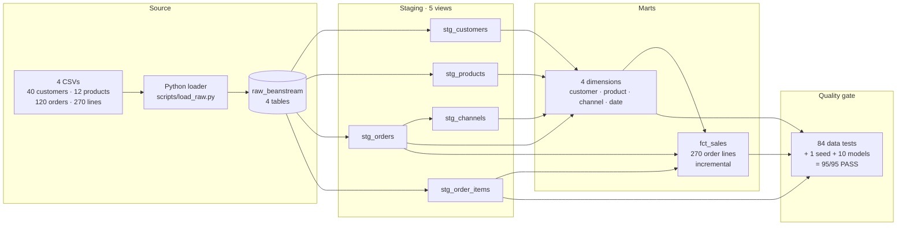
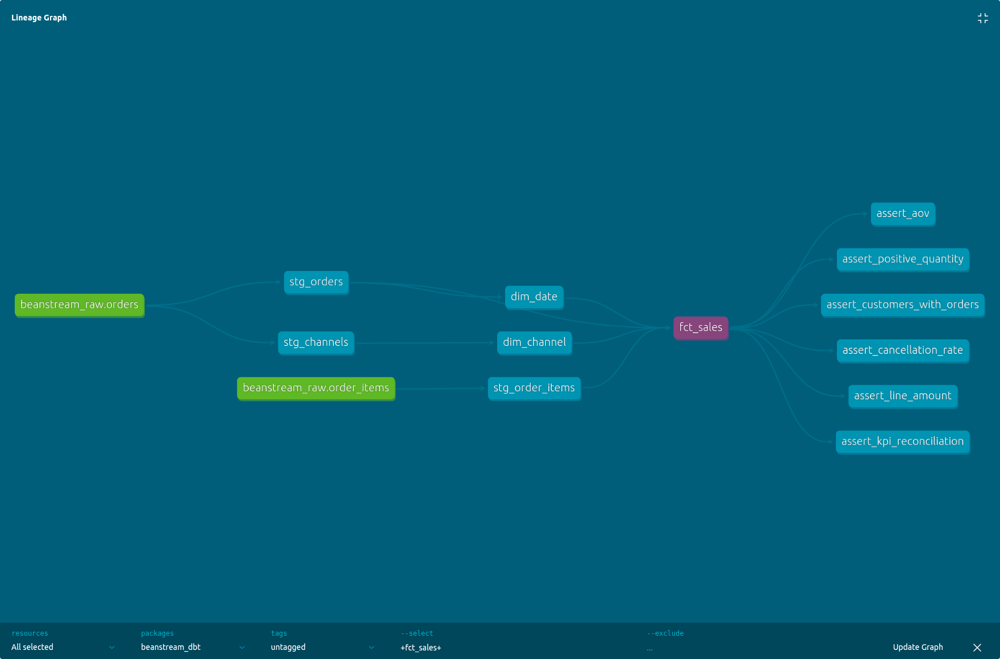
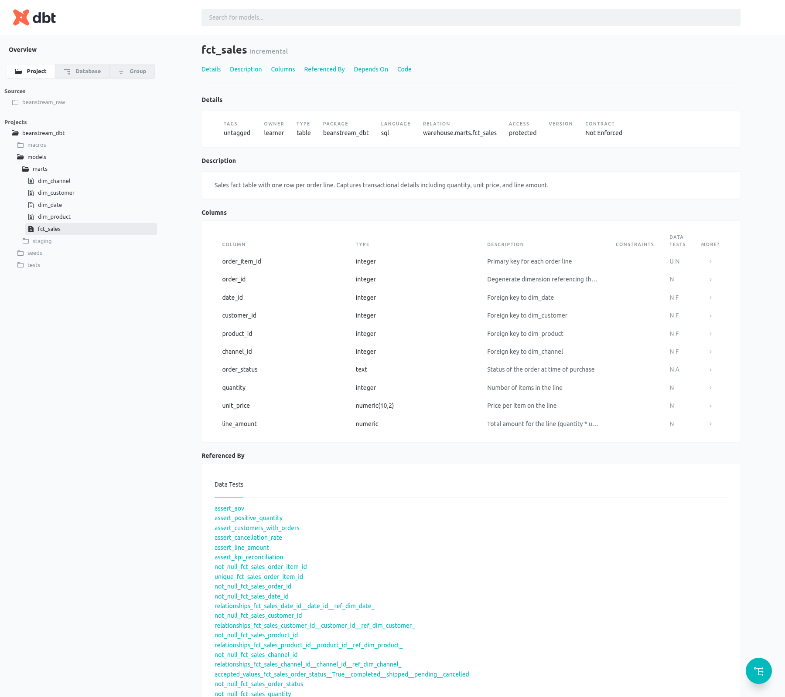
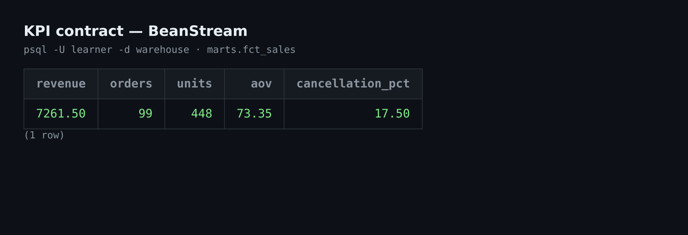

# BeanStream dbt

> **40 customers. 120 orders. 270 order lines. The interesting question is not whether the SQL runs — it is whether the numbers survive the next change.**

BeanStream is a synthetic coffee-subscription retailer with 2024-only source data, loaded into PostgreSQL and transformed with dbt. This project replaces a hand-written ETL with a tested warehouse: five staging views, four dimensions, one incremental fact, and a KPI contract that is checked on every build.

**Why it matters:** joining four tables is easy. Making revenue, orders, units, and cancellations unambiguous — and proving a rerun does not quietly change them — is the actual analytics-engineering work.

**Verified result:** `dbt build` passes **95/95** checks. The non-cancelled business reconciles to **$7,261.50 revenue**, **99 orders**, **448 units**, **$73.35 average order value**, and a **17.5% order cancellation rate** — while all **270 order lines**, cancellations included, remain in the fact.

[](https://www.getdbt.com/)
[](https://www.postgresql.org/)
[](#quality-gate)
[](LICENSE)

**Jump to:** [Architecture](#architecture) · [Data model](#data-model) · [Numbers](#the-numbers) · [Quickstart](#quickstart) · [Case study](CASE-STUDY.md)

---

<a id="what-this-is"></a>
## ☕ What this is

| | |
|---|---|
| **Source** | Four CSVs: 40 customers, 12 products, 120 orders, 270 order lines |
| **Warehouse** | PostgreSQL 16 in Docker Compose, exposed on port `5434` |
| **Transform** | dbt-core 1.12.6 with dbt-postgres 1.9.1 |
| **Shape** | 5 staging views → 4 dimensions + 1 incremental fact |
| **Contract** | 84 data tests, a seeded KPI reconciliation, and 95 total build checks |
| **Data** | Synthetic, seed 42, 2024 only — no real customers |

The source is intentionally small enough to inspect by hand and rich enough to expose the questions that matter: what is one row, when is a cancellation a cancellation, and what happens when the pipeline runs twice?

<a id="before-after"></a>
## 🔁 Before / after

| Concern | Hand-written ETL (starting point) | This dbt project |
|---|---|---|
| **Lineage** | Lives in the author's head | Four raw tables → five staging views → five marts, browsable in dbt docs |
| **Grain** | Implicit in Python | Declared: `fct_sales` is one row per `order_item_id` |
| **Tests** | Manual spot checks | 84 data tests + 11 build steps = 95/95 pass |
| **KPI drift** | Found after a board pack looks wrong | Seed-backed reconciliation runs on every build |
| **Cancellations** | Ambiguous filter buried in code | Retained in the fact; excluded only in the KPI layer |
| **Change safety** | Re-run and hope | `delete+insert` on `order_item_id`; two reruns inserted zero rows |
| **Handover** | Read the script | Docs site, data dictionary, glossary, and CI workflow in the repo |

<a id="architecture"></a>
## 🏗️ Architecture



*Caption: four CSVs load into `raw_beanstream`; five staging views clean them, four dimensions and one incremental fact serve the marts, and a 95-check `dbt build` gates the result.*

<a id="data-model"></a>
## 🔗 Data model

```mermaid
erDiagram
    raw_customers {
        int customer_id PK
        text email
        text city
        text country
    }
    raw_orders {
        int order_id PK
        int customer_id FK
        date order_date
        text status
        text channel
    }
    raw_order_items {
        int order_item_id PK
        int order_id FK
        int product_id FK
        int quantity
        numeric unit_price
    }
    raw_products {
        int product_id PK
        text product_name
        text category
        numeric unit_price
    }

    raw_customers ||--o{ raw_orders : "places"
    raw_orders ||--o{ raw_order_items : "contains"
    raw_products ||--o{ raw_order_items : "appears on"
```



*Caption: one customer places zero-or-many orders; one order contains zero-or-many lines; one product appears on zero-or-many lines — and `fct_sales` keeps `order_item_id`, `order_id`, `customer_id`, and `product_id` at that same line grain.*

*Cardinality legend: `||--o{` means one parent to zero-or-many children; read each relationship from left to right.*

The warehouse star is deliberately simple: `dim_customer` (40), `dim_product` (12), `dim_channel` (4), and `dim_date` (362) surround `fct_sales` (270). `order_id` stays in the fact as a degenerate dimension instead of becoming a separate `dim_order`.

<a id="the-numbers"></a>
## 📊 The numbers

| Layer | Metric | Verified value |
|---|---|---:|
| Raw | Customers / products / orders / order lines | 40 / 12 / 120 / 270 |
| Raw | Sales channels | 4 (`app`, `partner`, `retail`, `web`) |
| Staging | Models and tests | 5 views; 28/28 tests |
| Dimensions | `dim_customer` / `dim_product` / `dim_channel` / `dim_date` | 40 / 12 / 4 / 362 |
| Dimensions | `dim_date` range | 2024-01-01 → 2024-12-27 |
| Fact | Grain and keys | 270 rows; 270 unique `order_item_id`; 120 orders |
| Fact | Non-cancelled lines / orders / units | 230 / 99 / 448 |
| Fact | Cancelled lines / orders retained | 40 / 21 |
| KPI | Revenue, non-cancelled | **$7,261.50** |
| KPI | Orders, non-cancelled | **99** |
| KPI | Units, non-cancelled | **448** |
| KPI | Average order value | **$73.35** |
| KPI | Cancellation rate, order grain | **17.5%** (21 / 120) |
| KPI | Customers with at least one order | **39** of 40 |
| Quality | `dbt build` | **95/95** — 1 seed + 10 models + 84 data tests |
| Quality | Two incremental reruns | `INSERT 0 0` each; 270 rows / 270 keys / max ID 270 |
| Quality | Full refresh | 270 rows |

<a id="quality-gate"></a>
## 🧪 Quality gate

The build is the claim. The exact final line is:

```text
Done. PASS=95 WARN=0 ERROR=0 SKIP=0 NO-OP=0 REUSED=0 TOTAL=95
```

That is **1 seed** (`expected_kpis`), **10 models** (5 staging + 4 dimensions + `fct_sales`), and **84 data tests**. The tests cover source keys and relationships, accepted status and channel values, dimension uniqueness, fact foreign keys, line arithmetic, positive quantities, and the published KPI reconciliation.

The incremental fact uses `delete+insert` with `unique_key='order_item_id'`. Two normal reruns produced `INSERT 0 0` both times, leaving **270 rows / 270 keys / max ID 270**. A `--full-refresh` rebuild returns the same **270** rows. The append-only high-water filter is safe for new lines; a correction to an existing line needs a full refresh.

<a id="screenshots"></a>
## 📸 Screenshots



*The dbt lineage graph for `fct_sales`: raw order and order-item sources flow through staging and dimensions into the incremental fact, with the singular KPI tests downstream.*



*The `fct_sales` model page in dbt docs: incremental materialisation, column descriptions, and the tests attached to the fact.*



*KPI query result from `marts.fct_sales`: non-cancelled revenue **$7,261.50**, **99** orders, **448** units, **$73.35** AOV, and a **17.5%** cancellation rate.*

Capture provenance and the exact commands are recorded in [`screenshots/README.md`](screenshots/README.md).

<a id="quickstart"></a>
## ⚡ Quickstart

**Prerequisites:** Docker with Compose, `make`, Python 3.10+, and network access to pull `postgres:16`.

From the repository root:

```bash
make setup    # create .venv, install dbt 1.12.6 + dbt-postgres 1.9.1, copy profiles.yml
make up       # start PostgreSQL 16 on localhost:5434
make raw      # load the four CSVs into raw_beanstream
make build    # seed + 10 models + 84 data tests
make docs     # generate the dbt docs site
make serve    # browse the lineage and catalog at http://localhost:8080
```

Expected raw load:

```text
customers: 40
order_items: 270
orders: 120
products: 12
```

Expected build:

```text
Finished running 1 incremental model, 1 seed, 4 table models, 84 data tests, 5 view models
Completed successfully
Done. PASS=95 WARN=0 ERROR=0 SKIP=0 NO-OP=0 REUSED=0 TOTAL=95
```

`make all` runs setup, up, raw, build, and docs in one sequence. To rebuild the incremental fact from scratch, use `make full-refresh`.

<a id="evidence"></a>
## 🧾 Evidence

Run the KPI query directly against the warehouse:

```sql
select
    round(sum(line_amount) filter (where order_status <> 'cancelled'), 2) as revenue,
    count(distinct order_id) filter (where order_status <> 'cancelled') as orders,
    sum(quantity) filter (where order_status <> 'cancelled') as units,
    round(
        sum(line_amount) filter (where order_status <> 'cancelled')
        / count(distinct order_id) filter (where order_status <> 'cancelled'),
        2
    ) as aov,
    round(
        100.0 * count(distinct case when order_status = 'cancelled' then order_id end)
        / count(distinct order_id),
        2
    ) as cancellation_pct
from marts.fct_sales;
```

Expected:

```text
 revenue | orders | units |  aov  | cancellation_pct
---------+--------+-------+-------+------------------
 7261.50 |     99 |   448 | 73.35 |            17.50
```

Other evidence:

- **KPI contract:** `seeds/expected_kpis.csv` is reconciled by `tests/assert_kpi_reconciliation.sql`.
- **Line-level checks:** `assert_line_amount.sql` and `assert_positive_quantity.sql`.
- **Grain proof:** 270 rows, 270 distinct `order_item_id`, 120 distinct `order_id`.
- **CI workflow:** `.github/workflows/dbt-ci.yml` starts `postgres:16`, loads the raw CSVs, and runs `dbt build`. The workflow is committed; the first green GitHub run is pending the first push, so no CI badge is shown yet.

<a id="design-decisions"></a>
## 🧠 Design decisions

| Decision | Why | Accepted trade-off |
|---|---|---|
| **One row per order line** | `order_item_id` is the natural, stable grain; every measure is additive at that level. | Reporting by order must aggregate lines explicitly. |
| **Keep cancellations in the fact** | Removing them would destroy the ability to audit cancellation rate and order history. | Every downstream KPI must filter `order_status <> 'cancelled'`. |
| **Cancellation rate at order grain** | The business question is “how many orders were cancelled?” — 21 of 120. A line-share would be biased by basket size. | It does not report cancelled-unit share, which is a different metric. |
| **`order_id` as a degenerate dimension** | The order header has no useful attributes beyond status, date, channel, and customer — all already in the fact. | No separate `dim_order` for order-level attributes. |
| **Deterministic channel IDs** | Alphabetical distinct channels give stable IDs: `app=1`, `partner=2`, `retail=3`, `web=4`. | IDs change if a new channel sorts earlier. |
| **Bounded date spine** | `dim_date` is generated from the observed order dates, giving 362 rows from 2024-01-01 to 2024-12-27. | There are no dates outside the observed range. |
| **Incremental `delete+insert`** | It is simple on PostgreSQL, keyed to `order_item_id`, and makes reruns idempotent. | The high-water filter only appends new IDs; late-arriving corrections to existing lines require `make full-refresh`. |
| **Tests at source, model, and KPI level** | A passing build should mean the contract holds, not just that SQL executed. | The YAML and singular tests are maintenance work. |

The incremental limitation is deliberate and visible: the filter is `order_item_id > max(order_item_id)` in the target. That is correct for an append-only feed and prevents duplicate rows on reruns. It does **not** catch a corrected `quantity` or `unit_price` on an existing line. The next iteration would add an `updated_at` column and a merge strategy or a bounded lookback window.

<a id="limits"></a>
## 🚧 Limits

- **Synthetic data only.** Seed 42, 2024 only, 40 customers and 270 lines. No real customers, payments, delivery, invoices, or returns.
- **One customer has no orders.** `dim_customer` has 40 rows; the fact has 39 distinct customers. The relationship is one-to-zero-or-many.
- **No SCD history.** Dimensions are current-state snapshots. `dim_product.unit_price` is the current catalog price; use `fct_sales.unit_price` for the price charged on a line.
- **Incremental is a correctness pattern here, not a scale claim.** 270 rows do not need incremental processing; the point is that the rerun is idempotent.
- **No orchestration or cloud deployment.** The project runs locally and in a single CI job; it does not include scheduling, monitoring, or alerting.
- **Date text names depend on the PostgreSQL locale.** Numeric date fields are stable for logic; use those.
- **The first GitHub CI run is pending.** The workflow is present, but this README does not claim a green remote build until it exists.

<a id="learning-lab"></a>
## 🪜 Built as a learning lab

This repository is also a training artifact. The modelling work follows a seven-stage ladder: **sources + `stg_customers` → remaining staging views → four dimensions → `fct_sales` → tests and KPI reconciliation → incremental safety → evidence and publication**. Each stage has a standalone card — Task 1 in [`START-HERE.md`](START-HERE.md), Tasks 2–7 in [`TASKS.md`](TASKS.md) — with a runnable starting check, exact files, expected result, and stop condition.

The ladder is included as a replayable design record, not a to-do list. The models, tests, and numbers above are the built result; the cards show how the result was earned and how to extend it.

<a id="document-map"></a>
## 🗺️ Document map

| Document | Read it for |
|---|---|
| [STATUS.md](STATUS.md) | Current project state, gate, blockers, and next action |
| [START-HERE.md](START-HERE.md) | The first task card and the lab entry point |
| [TASKS.md](TASKS.md) | Standalone task cards for stages 2–7 |
| [docs/guide.md](docs/guide.md) | First run, everyday commands, reset, and troubleshooting |
| [docs/data-dictionary.md](docs/data-dictionary.md) | Grain, keys, columns, relationships, rules, and KPI formulas |
| [docs/glossary.md](docs/glossary.md) | Plain-English definitions of source, grain, dimension, fact, and key |
| [PROGRESS.md](PROGRESS.md) | Short session handoff and resume commands |
| [CASE-STUDY.md](CASE-STUDY.md) | The problem, decisions, result, and what I would change |
| [screenshots/README.md](screenshots/README.md) | Screenshot capture contract and provenance |

<a id="next"></a>
## 🔜 What I would do next

1. **Handle late-arriving corrections.** Add `updated_at` to the raw contract, switch the fact to a merge or bounded lookback, and test that a changed line is updated once.
2. **Add model contracts and exposures.** Make the KPI columns explicitly typed and connect them to the downstream reporting surface.
3. **Publish the first CI run.** Push the repository, confirm the `postgres:16` service job is green, then add the CI badge and link the run.
4. **Stress the incremental path.** Generate a larger synthetic feed and a correction batch so the append-only limit is demonstrated, not just documented.
5. **Add orchestration and freshness checks.** Schedule the build, alert on failure, and stop treating a local `make build` as the only operational signal.

<a id="license"></a>
## 📄 License

MIT for the project code and documentation. The synthetic data is attributed in [`NOTICE.md`](NOTICE.md); provenance and upstream licence are recorded there. No real customer data is included.
