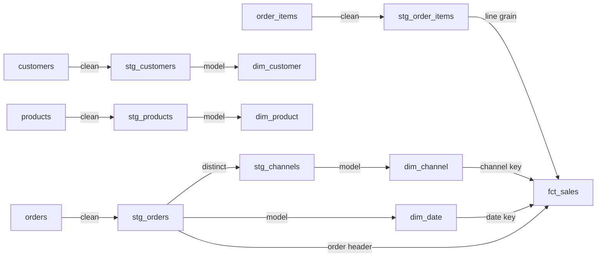
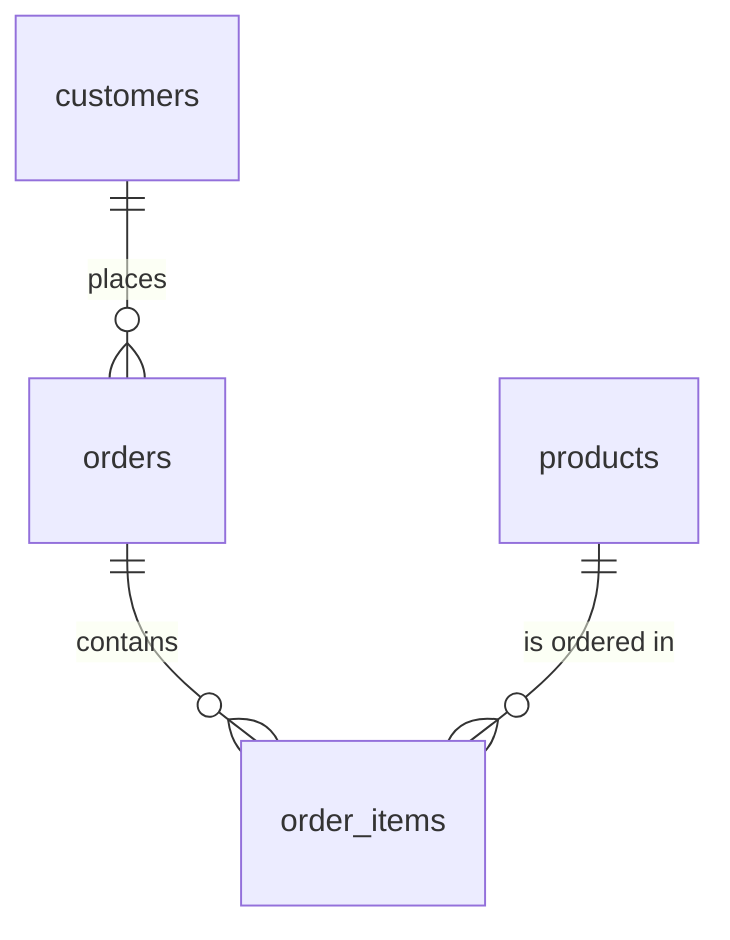

# BeanStream dbt — data dictionary

BeanStream is a fictional coffee-subscription retailer. This is the data contract behind its dbt
models: grain, keys, columns, business rules, and the numbers the tests expect. Use this when you are
writing SQL, reviewing a change, or explaining the project.

**Source:** synthetic BeanStream OLTP extracts, seed 42, **2024 only**.
**Fact grain:** one row per order line.
**Currency:** not stored as a currency code; values are treated as a single reporting currency.

> 🧭 **How to use this:** looking for a run command? Use the [operator's guide](guide.md). Looking for a
> definition? Stay here. The three things to remember: one row per order line, cancelled orders stay
> in the fact, and the published KPIs filter them downstream.

---

## 🗺️ Lineage at a glance



*Caption: five staging views feed four dimensions and one fact. The fact is the only incremental
model; the rest are views or tables.*

| Layer | Schema | Materialisation |
|---|---|---|
| Raw | `raw_beanstream` | Tables loaded by Python |
| Staging | `staging` | Views |
| Marts | `marts` | Tables, except `fct_sales` (incremental) |
| Seed | `seeds` | `expected_kpis` |

---

## 🔗 Relationships

**Lineage shows dependency; an ERD shows cardinality.** This project has two relationship views: the
normalised source and the warehouse star schema.

<a id="source-relationships"></a>
### Source relationships



*Caption: a customer places many orders; an order contains many lines; a product appears on many
lines. Each child row points to exactly one parent.*

*Cardinality key: `||--o{` means one-to-zero-or-many; `}o--||` means zero-or-many-to-one.*

| Parent | Child | Cardinality | Join key | Enforced by |
|---|---|---|---|---|
| `customers` | `orders` | 1 : many | `customer_id` | Raw FK + dbt relationship test |
| `orders` | `order_items` | 1 : many | `order_id` | Raw FK + dbt relationship test |
| `products` | `order_items` | 1 : many | `product_id` | Raw FK + dbt relationship test |

### Warehouse relationships

| Dimension | Fact | Cardinality | Join key | Enforced by |
|---|---|---|---|---|
| `dim_customer` | `fct_sales` | 1 : many | `customer_id` | dbt relationship test |
| `dim_product` | `fct_sales` | 1 : many | `product_id` | dbt relationship test |
| `dim_channel` | `fct_sales` | 1 : many | `channel_id` | dbt relationship test |
| `dim_date` | `fct_sales` | 1 : many | `date_id` | dbt relationship test |

`fct_sales.order_id` is a **degenerate dimension**: it identifies the order header but has no
separate `dim_order` table. The source-side order header is flattened into the fact.

One customer has no orders, so the relationship is one-to-zero-or-many in practice; the test still
enforces that every non-null fact key resolves to a dimension row.

---

## 🗄️ Raw layer — `raw_beanstream`

The loader drops and recreates this schema on every `make raw`. There are four raw tables:
`customers`, `products`, `orders`, and `order_items`. **There is no `channels` table**;
`stg_channels` is derived from distinct `orders.channel` values.

### `raw_beanstream.customers`

| Column | Type | Rules |
|---|---|---|
| `customer_id` | integer | Primary key, not null |
| `first_name` | text | Not null |
| `last_name` | text | Not null |
| `email` | text | Not null, unique |
| `city` | text | Not null |
| `country` | text | Not null |
| `signup_date` | date | Not null |
| `_loaded_at` | timestamptz | Defaults to `NOW()`; source freshness field |

**Grain:** one customer.
**Rows:** 40.

### `raw_beanstream.products`

| Column | Type | Rules |
|---|---|---|
| `product_id` | integer | Primary key, not null |
| `product_name` | text | Not null |
| `category` | text | Not null |
| `unit_price` | numeric(10,2) | Not null, `>= 0` |
| `active` | boolean | Not null |
| `_loaded_at` | timestamptz | Defaults to `NOW()` |

**Grain:** one product.
**Rows:** 12.

### `raw_beanstream.orders`

| Column | Type | Rules |
|---|---|---|
| `order_id` | integer | Primary key, not null |
| `customer_id` | integer | Not null, FK → customers |
| `order_date` | date | Not null |
| `status` | text | `completed`, `shipped`, `pending`, `cancelled` |
| `channel` | text | `web`, `app`, `retail`, `partner` |
| `_loaded_at` | timestamptz | Defaults to `NOW()` |

**Grain:** one order header.
**Rows:** 120.

### `raw_beanstream.order_items`

| Column | Type | Rules |
|---|---|---|
| `order_item_id` | integer | Primary key, not null |
| `order_id` | integer | Not null, FK → orders |
| `product_id` | integer | Not null, FK → products |
| `quantity` | integer | Not null, `> 0` |
| `unit_price` | numeric(10,2) | Not null, `>= 0` |
| `_loaded_at` | timestamptz | Defaults to `NOW()` |

**Grain:** one order line.
**Rows:** 270.

---

## 🧹 Staging layer — `staging`

Staging views clean and cast; they do not join across business entities except for the channel list.

### `stg_customers`

| Column | Type | Notes |
|---|---|---|
| `customer_id` | integer | Key |
| `first_name` | text | Trimmed |
| `last_name` | text | Trimmed |
| `email` | text | Trimmed, lowercased |
| `city` | text | Trimmed |
| `country` | text | Trimmed |
| `signup_date` | date | Unchanged |

### `stg_products`

| Column | Type | Notes |
|---|---|---|
| `product_id` | integer | Key |
| `product_name` | text | Trimmed |
| `category` | text | Trimmed |
| `unit_price` | numeric(10,2) | Cast |
| `active` | boolean | Unchanged |

### `stg_orders`

| Column | Type | Notes |
|---|---|---|
| `order_id` | integer | Key |
| `customer_id` | integer | FK to customer |
| `order_date` | date | Cast |
| `order_status` | text | Lowercased, trimmed `status` |
| `channel` | text | Lowercased, trimmed |

### `stg_order_items`

| Column | Type | Notes |
|---|---|---|
| `order_item_id` | integer | Key |
| `order_id` | integer | FK to order |
| `product_id` | integer | FK to product |
| `quantity` | integer | Cast |
| `unit_price` | numeric(10,2) | Cast |
| `line_amount` | numeric | `round(quantity * unit_price, 2)` |

### `stg_channels`

| Column | Type | Notes |
|---|---|---|
| `channel_id` | integer | `row_number()` ordered by channel |
| `channel` | text | Distinct channel value |

**Deterministic IDs:** alphabetical order gives `app=1`, `partner=2`, `retail=3`, `web=4`.

---

## 🧱 Mart layer — `marts`

### `dim_customer`

| Column | Type | Notes |
|---|---|---|
| `customer_id` | integer | Primary key |
| `full_name` | text | `first_name || ' ' || last_name` |
| `email` | text | Cleaned email |
| `city` | text | Cleaned city |
| `country` | text | Cleaned country |
| `signup_date` | date | Signup date |

**Grain:** one customer.
**Rows:** 40.

### `dim_product`

| Column | Type | Notes |
|---|---|---|
| `product_id` | integer | Primary key |
| `product_name` | text | Cleaned name |
| `category` | text | Cleaned category |
| `unit_price` | numeric(10,2) | Current catalog price |

**Grain:** one product.
**Rows:** 12.
**Note:** this is the current product price, not the historical line price. Use
`fct_sales.unit_price` for the price actually charged on an order line.

### `dim_channel`

| Column | Type | Notes |
|---|---|---|
| `channel_id` | integer | Primary key, deterministic |
| `channel` | text | `app`, `partner`, `retail`, `web` |

**Grain:** one channel.
**Rows:** 4.

### `dim_date`

| Column | Type | Notes |
|---|---|---|
| `date_id` | integer | `YYYYMMDD`, primary key |
| `full_date` | date | Calendar date |
| `year` | integer | 2024 |
| `quarter` | integer | 1–4 |
| `month` | integer | 1–12 |
| `month_name` | text | Postgres `FMMonth` |
| `day` | integer | Day of month |
| `day_of_week` | integer | ISO: Monday=1 … Sunday=7 |
| `day_name` | text | Postgres `FMDay` |
| `is_weekend` | boolean | ISO day 6 or 7 |
| `month_start` | date | First day of the month |

**Grain:** one day.
**Range:** derived from min/max `orders.order_date`; currently **2024-01-01 to 2024-12-27**
(**362** days).
**Note:** the text names follow the Postgres locale. The numeric fields are stable.

### `fct_sales`

| Column | Type | Notes |
|---|---|---|
| `order_item_id` | integer | Primary key; fact grain |
| `order_id` | integer | Order header ID |
| `date_id` | integer | FK → `dim_date.date_id` |
| `customer_id` | integer | FK → `dim_customer.customer_id` |
| `product_id` | integer | FK → `dim_product.product_id` |
| `channel_id` | integer | FK → `dim_channel.channel_id` |
| `order_status` | text | `completed`, `shipped`, `pending`, `cancelled` |
| `quantity` | integer | Units on the line |
| `unit_price` | numeric(10,2) | Price charged on the line |
| `line_amount` | numeric | `quantity * unit_price`, rounded to 2dp |

**Grain:** one order line.
**Rows:** 270.
**Materialisation:** incremental, `delete+insert` on `order_item_id`.
**Cancelled orders:** retained in the fact. Downstream measures filter them.

### Sample rows

Five actual order lines, joined to the order header and product name for readability:

| order_item_id | order_id | order_date | status | channel | product | quantity | unit_price | line_amount |
|---:|---:|---|---|---|---|---:|---:|---:|
| 1 | 1 | 2024-12-23 | shipped | app | Single-Origin Ethiopia | 1 | 18.75 | 18.75 |
| 2 | 1 | 2024-12-23 | shipped | app | Loose-Leaf Earl Grey | 1 | 9.50 | 9.50 |
| 3 | 2 | 2024-07-13 | completed | app | Ceramic Dripper | 2 | 22.00 | 44.00 |
| 4 | 2 | 2024-07-13 | completed | app | BeanStream House Blend | 3 | 12.50 | 37.50 |
| 5 | 2 | 2024-07-13 | completed | app | Herbal Chamomile | 3 | 8.25 | 24.75 |

The incremental filter is:

```sql
where order_item_id > (select coalesce(max(order_item_id), 0) from {{ this }})
```

That appends new lines only. A correction to an existing line requires `make full-refresh`.

---

## 🌱 Seed — `seeds.expected_kpis`

| Column | Type | Notes |
|---|---|---|
| `metric` | text | `revenue`, `orders`, `units`, `customers`, `products` |
| `expected` | numeric | Reconciliation target |

The seed is tested against `fct_sales` and the dimensions by
`tests/assert_kpi_reconciliation.sql`.

---

## 📊 KPI definitions

| KPI | Definition | Verified |
|---|---|---:|
| Revenue | `SUM(line_amount)` where `order_status <> 'cancelled'` | **7,261.50** |
| Orders | `COUNT(DISTINCT order_id)` where `order_status <> 'cancelled'` | **99** |
| Units | `SUM(quantity)` where `order_status <> 'cancelled'` | **448** |
| Average order value | Revenue ÷ Orders | **73.35** |
| Cancellation rate | Cancelled orders ÷ all orders = 21 ÷ 120 | **17.5%** |
| Customers | `COUNT(*)` from `dim_customer` | **40** |
| Products | `COUNT(*)` from `dim_product` | **12** |
| Customers with orders | Distinct customers in the fact | **39** |

### Source population

| Status | Orders |
|---|---:|
| `completed` | 51 |
| `shipped` | 29 |
| `pending` | 19 |
| `cancelled` | 21 |
| **Total** | **120** |

| Channel | Orders |
|---|---:|
| `app` | 54 |
| `web` | 39 |
| `partner` | 16 |
| `retail` | 11 |
| **Total** | **120** |

---

## ⚠️ Known quirks

> ⚠️ **These are expected, not defects.**

- **2024 only.** No prior-year comparison is meaningful.
- **One customer has no orders.** `dim_customer` has 40 rows; the fact has 39 distinct customers.
- **Cancelled orders are in the fact.** That is intentional; the KPI filter excludes them.
- **No SCD history.** Dimensions are current-state snapshots.
- **No payment, delivery, invoice, or returns data.**
- **Incremental is a pattern, not a scale claim.** 270 rows do not require it.
- **Date text names depend on the Postgres locale.** Use numeric date fields for logic.
- **`dim_product.unit_price` is current price.** Use the fact's `unit_price` for historical line value.

---

## 🧪 Tests attached to this contract

| Test | What it protects |
|---|---|
| Source `not_null` / `unique` | Primary keys and required fields |
| Source `relationships` | Orders → customers, lines → orders/products |
| Source `accepted_values` | Status and channel vocabularies |
| Model key tests | Dimension and fact keys stay unique/not-null |
| Fact relationship tests | Every fact key resolves to a dimension |
| `assert_line_amount` | `line_amount = quantity * unit_price` |
| `assert_positive_quantity` | No zero or negative units |
| `assert_kpi_reconciliation` | The published numbers do not drift |

---

## 🔗 Related

- [README](../README.md) — project story and quickstart.
- [Operator's guide](guide.md) — runbook and troubleshooting.
- [Seed data notes](../data/README.md) — provenance and row counts.
